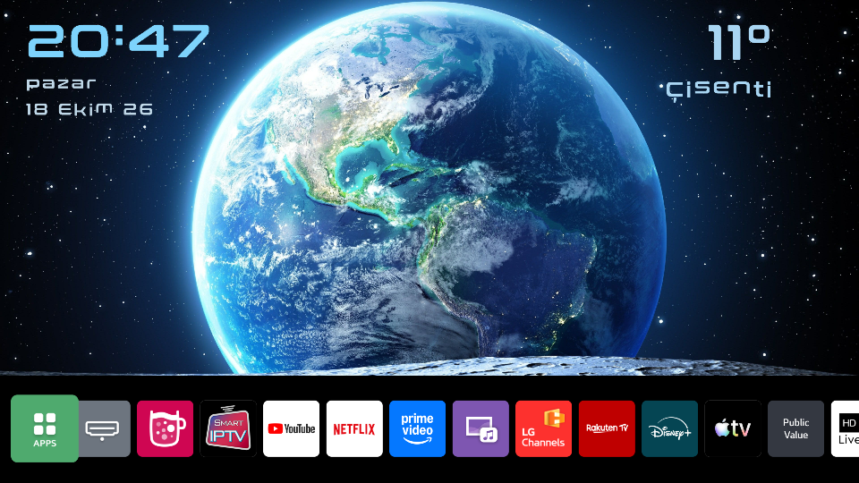

# lg-webos-homescreen

Stock-home-screen customization for rooted LG TVs running **webOS 25 / 10.x** (Flutter-based home app, `com.webos.app.home`). Replaces the hero-banner wallpaper with an Earth "Blue Marble" image and renders a **clock, weekday and date (top-left)** plus **live weather (top-right)** directly into it — without touching the read-only system partition.

Developed and verified on an LG 65QNED70A6A (webOS 10.3.1, firmware 33.31.61).



## Why it works this way

On webOS 24 and earlier the home screen was QML, so you could inject real widgets (see [mareklarek's guide](https://www.reddit.com/r/LGOLED/comments/1wf77wy/guide_for_modding_home_screen_of_lg_tvs_on_webos/), whose clock/weather design this project adapts — its built-in `time` item does not render in the main layout, and unknown widget items are silently ignored). On webOS 25 the home app is a compiled **Flutter** binary: there is no runtime extension point, and the only visible surface a mod can reach is the **hero-banner asset** the app loads on startup.

So this project renders clock/date/weather **into the PNG wallpaper** with a small generator daemon. The trade-off is stated plainly under [Limitations](#limitations).

## Architecture

```
TV (rooted, webOS 25)
├─ home-overlay.sh              kernel overlay mount over the stock home assets
│                                 lowerdir = original flutter_assets/assets
│                                 upperdir = overlay-upper/  (on flash, persists)
│                                 workdir  = overlay-work/   (on flash, persists)
├─ init.d/52-home-overlay       applies the overlay at every boot (webosbrew)
├─ init.d/53-bg-clock.sh        starts the wallpaper generator at boot
└─ tld.my.customhome/
   ├─ bg-generator.py           renders bg_banner_img.png (pure Python, no PIL)
   ├─ assets/sprites/*.raw      Conthrax glyph atlases (RGBA + JSON metadata)
   ├─ assets/images/bg_4k.raw   Earth background source (3840x1679 RGB)
   └─ assets/home*.xml          layout overrides (extract from YOUR TV — see below)

Mac / PC
└─ tools/build_sprites.py       renders the glyph atlases with Pillow
```

Layout on screen:

```
20:41                     11°
Pazartesi                 Çisenti
18 Ekim 26
```

- **Clock** `#7dd3fc` (208 px), **weekday/date** `#c0d8e8` (72 px), **weather** `#a8d5f2` (224/96 px) — colors and sizes follow the QML guide's clock/home-assistant widgets (sections 6.4-6.6).
- Font: [Conthrax SemiBold](https://www.dafont.com/conthrax.font) (Typodermic, free for commercial use).
- Weather: [Open-Meteo](https://open-meteo.com/) — no API key. Default location London, °C; change `LAT`/`LON` in `bg-generator.py`.

## Requirements

- Rooted TV with [Homebrew Channel / webosbrew](https://www.webosbrew.org/) and SSH access
- `Quick Start+` **disabled** (a real power cycle must happen at boot for the init.d hooks)
- Python 3 on the TV (present on webOS)
- The layout XML overrides are **model/firmware-specific**: extract `home*.xml` from `/usr/palm/applications/com.webos.app.home/data/flutter_assets/assets/` on *your* TV and place them under `assets/`. They are not included here (LG copyrighted material).

## Install

```sh
TV=root@<tv-ip>
APP=/media/developer/apps/usr/palm/applications/tld.my.customhome

# 1) copy the app
scp -r bg-generator.py home-overlay.sh assets "$TV:$APP/"

# 2) boot hooks (init.d runs files in name order)
scp init.d/53-bg-clock.sh "$TV:/var/lib/webosbrew/init.d/53-bg-clock"
ssh "$TV" chmod +x "$APP/home-overlay.sh" /var/lib/webosbrew/init.d/53-bg-clock

# 3) apply overlay + start the generator
ssh "$TV" sh "$APP/home-overlay.sh"
ssh "$TV" "cd $APP && nohup python3 bg-generator.py >/dev/null 2>&1 &"

# 4) restart the home app so it reloads the asset
ssh "$TV" "pkill -f '[f]lutter-client'; sleep 3; \
  luna-send -n 1 -f luna://com.webos.service.applicationmanager/launch \
  '{\"id\":\"com.webos.app.home\"}' < /dev/null"
```

Log: `/tmp/bg-generator.log`.

## Recovery

```sh
# soft: drop the overlay and restart home
ssh "$TV" "umount /usr/palm/applications/com.webos.app.home/data/flutter_assets/assets; \
  pkill -f '[c]om.webos.app.home'"

# hard: disable the mod entirely, then reboot
ssh "$TV" touch /media/developer/apps/usr/palm/applications/tld.my.customhome/DISABLED
ssh "$TV" reboot
```

A factory reset removes root and every change.

## Rebuilding the assets

```sh
# glyph atlases (needs Pillow + the Conthrax font)
python3 tools/build_sprites.py

# background: crop any 3840x2160 image to the hero height (top kept):
#   3840 x 1679 from (0,0) -> save as raw RGB -> assets/images/bg_4k.raw
```

## Limitations

- **The clock is a still image.** Flutter caches the banner asset while the home app is open, so a re-render only appears after the home app restarts. Render while home is closed; when home opens it shows the current time, then stays static until the next restart. The QML guide's blinking colon and live ticking are impossible on the Flutter home.
- Element names in the layout XML vary by model/region; the overlay only shadows files you actually provide.
- A firmware update may change the home app; re-extract the XML files and re-test after any OTA.

## Credits

- [mareklarek/webos10-homescreen-customization](https://github.com/mareklarek/webos10-homescreen-customization) — the QML guide whose clock/weather design is adapted here
- ArnoldDeRuiter (issue #2 on the repo above) — the `mount -t overlay` optimization for webOS 10.3.1, and the i18n symlink-shadow trick
- [webOSBrew](https://www.webosbrew.org/) — root, Homebrew Channel, init.d
- [Open-Meteo](https://open-meteo.com/) — free weather API

## Disclaimer

You modify your TV at your own risk. This repository is not affiliated with or endorsed by LG. Everything here is reversible (overlay mount + boot hook), but a mistake can still leave you with a broken home screen until you recover over SSH — make sure SSH works before you start.
